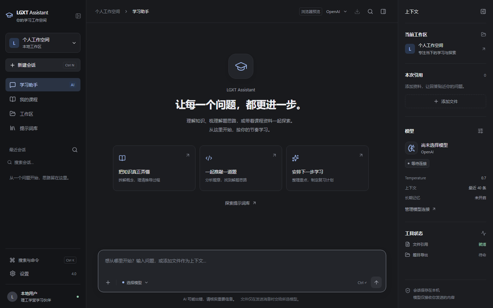

# LGXT Assistant

A learning assistant for course/assignment review, AI study chat and local document exports.

[简体中文与桌面操作参考](README.zh-CN.md) · [Releases](https://github.com/styayur/LGXT-Assistant/releases) · [Issues](https://github.com/styayur/LGXT-Assistant/issues)

**Beta.** Windows web, Windows desktop and Android have independent versions. A successful interface test is not proof of live course access, grade submission or paid-provider compatibility.



This existing capture shows a browser preview of the desktop-channel UI, not a native Windows capture or the v4.1.0 web release. Fixture screenshots contain example courses/grades/chat; see [verification boundaries](docs/VERIFICATION.md) for separate native startup evidence.

## Choose a channel

| Channel | Entry | Requirements and boundary |
| --- | --- | --- |
| Windows web | [v4.1.0-web](https://github.com/styayur/LGXT-Assistant/releases/tag/v4.1.0-web) | Main Windows browser channel, local Python service packaged as an EXE; not a hosted/static website |
| Windows desktop | [v4.0.1](https://github.com/styayur/LGXT-Assistant/releases/tag/v4.0.1) | Modern WebView2 desktop; EXE or full portable ZIP |
| Android | [v3.2.1](https://github.com/styayur/LGXT-Assistant/releases/tag/v3.2.1) | Separate Flet client; use its APK/notes, not Windows version assumptions |
| Legacy Tk | `py -3.13 default.pyw --legacy` | Compatibility path; not the main new-feature UI |

[Release-channel rules](docs/release-channels.md) describe newer naming conventions. Historical assets retain compatibility names; do not infer a platform version from whichever release sorts latest.

## Windows web: download and start

On Windows 10/11 x64, download the Windows Web EXE and checksums from [v4.1.0-web](https://github.com/styayur/LGXT-Assistant/releases/tag/v4.1.0-web). Compare its full SHA-256 with the matching checksum entry before running. It starts a local service and opens Edge/Chrome; no Python, Node.js or WebView2 installation is needed.

Keep the startup terminal open and press Ctrl+C when finished. Refreshing the tab preserves access during that run; after a service restart, use the new startup link. The service binds to `127.0.0.1`, checks origin and uses a per-run connection credential. Do not share that link or expose the service publicly. It shares `%APPDATA%/LGXT-Assistant` data and system credentials with the desktop app; avoid simultaneous edits in both channels.

See [web release details and recorded tests](docs/releases/v4.1.0-web.md). Full functionality needs the local service; GitHub Pages cannot host it as a static site.

## Windows desktop: download and first use

The [v4.0.1 release](https://github.com/styayur/LGXT-Assistant/releases/tag/v4.0.1) provides a single-file EXE, portable ZIP, Chinese PDF guide and `SHA256SUMS.txt`. Verify and fully extract the portable ZIP, keep `_internal` beside its EXE, and run the main program. Do not run inside the archive or download GitHub's source archive expecting an executable. Windows 10/11 x64 and [WebView2](https://developer.microsoft.com/microsoft-edge/webview2/) are required; no Python/Node.js is needed for this download. No new MSI is supplied.

1. Open My courses and sign into the learning platform with your own authorized account. AI configuration is independent of course browsing/export.
2. Inspect courses, assignments, questions and images; set an export directory/format for Word/PDF. Review the target and score before any explicitly confirmed grade operation.
3. Configure endpoint, available model ID and key under AI settings, then Save and test connection. Testing sends a short request and may incur provider charges.
4. Add text/code/images to the workspace and explicitly reference them in chat. PDF/Word are not direct chat attachments; copy relevant text or use a screenshot.

Messages and referenced material go to the chosen model service. Main navigation/chat support English and Chinese; settings and course management remain mainly Chinese. See the [Chinese desktop guide](README.zh-CN.md), [PDF](output/pdf/LGXT-Assistant-4.0.1-User-Guide.pdf) and [release notes](docs/releases/v4.0.1.md).

## Development and verification

Use Python 3.13, Node.js 22 and WebView2 for the modern desktop source path:

```powershell
git clone https://github.com/styayur/LGXT-Assistant.git
cd LGXT-Assistant
py -3.13 -m pip install -r requirements.txt
cd frontend
npm ci
npm run build
cd ..
py -3.13 default.pyw
```

Use `py -3.13 web_app.py` for the local browser channel or `py -3.13 default.pyw --legacy` for legacy Tk. For tests, use a Python environment containing the dependencies:

```powershell
python -m pip install -r requirements-dev.txt playwright
python -m playwright install chromium
python -m pytest -q
python scripts/check_frontend.py
```

[Existing CI](https://github.com/styayur/LGXT-Assistant/actions/workflows/tests.yml) checks Python on Windows and frontend/browser fixtures on Ubuntu. [CONTRIBUTING.md](CONTRIBUTING.md), [architecture](docs/architecture.md) and [verification](docs/VERIFICATION.md) describe package/startup tests and separate Android boundaries. Builds and fixture tests do not certify real-account grade writes or paid AI calls; neither is performed for this documentation change.

## Data, limitations and roadmap

Close the app before copying `%APPDATA%/LGXT-Assistant` for backup; keep exported Word/PDF separately. Desktop history/workspace/preferences are under `desktop`, older export config uses `config.ini`. Account passwords and model keys live in the system credential store and are not part of that folder backup. Chat Markdown exports are not complete application backups.

Endpoints/models and platform availability depend on external services. There is no automatic vector retrieval; study preferences and file references are explicit. Web/desktop/Android channels differ, and UI fixtures are not real course records. Startup help/logs and preserved `.bak` files aid diagnosis; see [troubleshooting](README.zh-CN.md#打不开或登录失败). Redact credentials, student data and private course material before reporting.

Release naming consistency and update/backup hardening remain next work; broader local study integration is a future direction. This is not a general AI assistant. Use [Issues](https://github.com/styayur/LGXT-Assistant/issues) for redacted reproductions, [CONTRIBUTING.md](CONTRIBUTING.md) for PR checks and [SECURITY.md](SECURITY.md) for private vulnerability reports. Maintainers publish channel-specific tags/releases.

## License

Application source uses [AGPL-3.0-only](LICENSE). Historical attribution and third-party notices remain intact; see [NOTICE.md](NOTICE.md).
