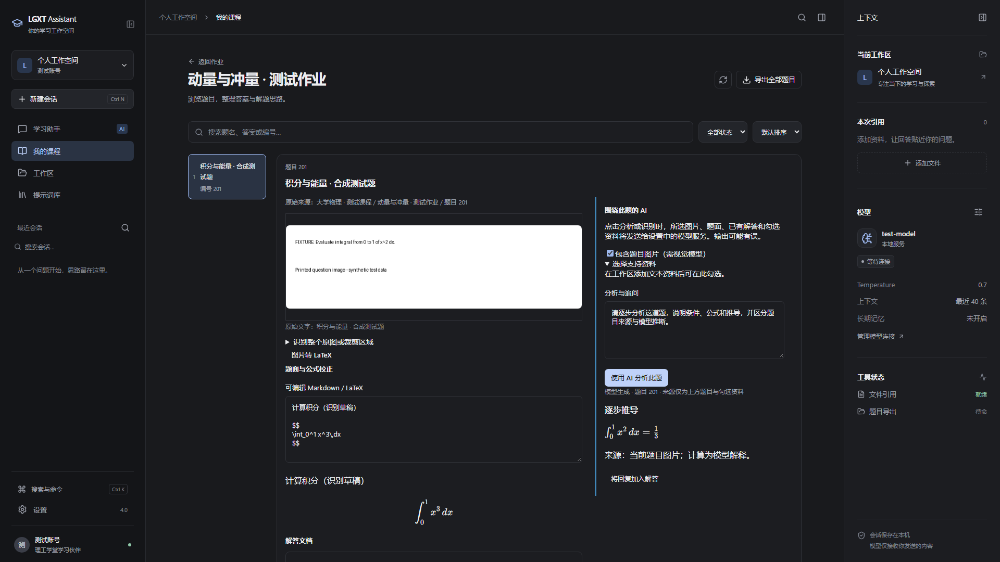

# LGXT Assistant · 理工学堂助手

A task-focused assistant for handling assignments on 理工学堂, from submission and image-to-LaTeX to AI-assisted problem solving and export.

**Beta.** Windows desktop, Windows web and Android are independently versioned and validated.

[中文](README.zh-CN.md) · [Releases](https://github.com/styayur/LGXT-Assistant/releases) · [Guide](docs/user-guide.md) · [Security](SECURITY.md) · [Verification](docs/VERIFICATION.md)

[](https://github.com/styayur/LGXT-Assistant/actions/workflows/tests.yml)
[](LICENSE)



Updated React assignment workspace with synthetic questions and model replies; browser capture, not a native Android screenshot.

## Start with an assignment

Open a course and assignment, then select a question. The assignment workspace keeps its original image, corrected question, editable LaTeX, solution document and AI discussion together. Select supporting text files explicitly; their names and excerpts remain visible as sources. AI explanations are marked as generated, not platform answers or verified citations.

- **Operations:** browse courses, deadlines, available attempt fields and reference answers; export assignment samples. “一键满分” supports the current assignment, course or all courses, with a counted preview, one confirmation, per-item results and cancellation of future requests.
- **Image-to-LaTeX:** recognize the whole original image or a percentage-based crop with your configured vision model. Inspect and correct the returned text and LaTeX before applying it. Printed formulas are the target; handwriting, diagrams and OCR accuracy are not guaranteed.
- **Question-bound AI:** “使用 AI 分析此题” sends the selected image, corrected question, existing solution and checked text sources to your configured provider. Follow up within the question and add reviewed responses to its solution. Text-only analysis remains available.
- **Documents:** Tiptap rich text, editable inline/block math, tables, code, images, headings, lists and undo/redo. Save locally with a previous-version copy. Export Markdown, Word or PDF; Word/PDF retain equations as **LaTeX source**, not native Word equations or typeset PDF formulas.
- **Android:** a separate Flet UI with clearer assignment states, zoomable original images, editable question/solution notes and explicit AI/recognition actions. Android currently uses an OpenAI-compatible vision endpoint with an in-memory key; it has no desktop rich-text editor, crop tool or Word/PDF export.

## Transport limitation

**The official HTTP endpoint responds, but HTTPS could not be verified on 24 October 2026.** Login and authenticated requests over HTTP are blocked by default. There is no automatic downgrade and certificate validation remains enabled. If you explicitly enable insecure compatibility for this login, passwords, tokens and grade traffic can be intercepted or altered. A persistent warning remains visible and platform credentials are not saved. Prefer a verified HTTPS API configured through `LGXT_API_BASE` where available. See [transport evidence and policy](SECURITY.md).

Images are restricted to the configured platform host, public destinations and supported raster formats. External hosts, redirects, private IP addresses, invalid images, oversized responses and unsafe data URLs are rejected. Some legitimate external image hosts may therefore be unavailable until independently reviewed.

AI calls are user-initiated and leave the local app. Confirm that the selected service/model supports images in AI settings; custom endpoints are not assumed to have vision. Provider rejection remains possible. No model key or real platform account is included.

## Download by channel

The release page and its assets are the source of truth; source archives are not runnable installers. New channel candidates are desktop **4.1.0**, web **4.2.0-web** and Android **3.3.0-android**. A candidate is available only after its channel gates and publication complete. See [channel policy](docs/release-channels.md) and [delivery evidence](docs/VERIFICATION.md).

| Channel | Previous published baseline | Installation |
| --- | --- | --- |
| Windows desktop | [v4.0.1](https://github.com/styayur/LGXT-Assistant/releases/tag/v4.0.1) | Windows 10/11 x64, WebView2; run the EXE or fully extract the portable ZIP and keep `_internal` beside its EXE |
| Windows web | [v4.1.0-web](https://github.com/styayur/LGXT-Assistant/releases/tag/v4.1.0-web) | Windows 10/11 x64; launch the Web EXE, retain its console, use its private loopback link in Edge/Chrome; no WebView2 needed |
| Android | [v3.2.1](https://github.com/styayur/LGXT-Assistant/releases/tag/v3.2.1) | Historical APK; the new Android source is not a signed production APK. Signing credentials and device verification are unavailable |

New Windows asset names identify channel, version and platform; check every download against that release's `SHA256SUMS.txt`. No MSI or signing trust is claimed. Historical tags/assets remain unchanged, including an old Android asset attached to a web release; use the Android baseline above for the historical Android channel.

## Local data and development

Windows documents, conversations and settings live under `%APPDATA%\LGXT-Assistant\desktop`. Close the app before backing up `%APPDATA%\LGXT-Assistant`; exports need their own backup. AI keys use the OS credential store. Android notes use local app storage; API keys stay in memory and old plaintext saved passwords are removed. Logout clears the active platform token.

Use Python 3.13 and Node.js 22 or later supported by Vite:

```powershell
py -3.13 -m pip install -r requirements.txt -r requirements-dev.txt
npm ci --prefix frontend
npm run build --prefix frontend
py -3.13 default.pyw        # WebView2 desktop
py -3.13 web_app.py         # loopback browser channel
py -3.13 default.pyw --legacy
```

[Architecture](docs/architecture.md) · [Editor decision and licenses](docs/editor-decision.md) · [Validation commands](CONTRIBUTING.md) · [Changelog](CHANGELOG.md)

Application source is [AGPL-3.0-only](LICENSE), copyright StyAyur. [Historical attribution and third-party notices](NOTICE.md) are preserved. Report vulnerabilities privately through [GitHub security advisories](https://github.com/styayur/LGXT-Assistant/security/advisories/new). [Issues](https://github.com/styayur/LGXT-Assistant/issues) are for non-sensitive bug reports.
