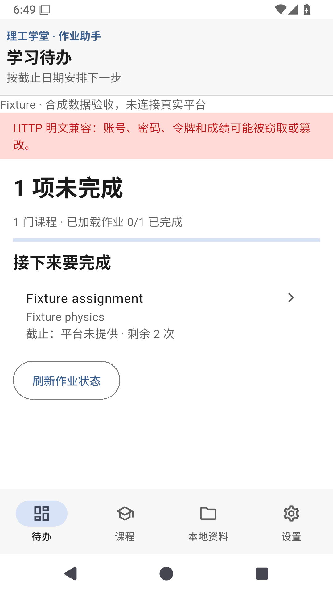

> Android 为当前开发目标；Windows Desktop/Web 历史版本与共享模块保留，本轮不新增 Windows 功能。

# LGXT Assistant · 理工学堂助手

以作业为中心的理工学堂助手：从提交管理、图片转 LaTeX，到 AI 辅助解题与学习资料导出。

**Android 3.3.2 Beta。** Android 为当前产品；Windows 历史渠道与共享业务模块保留。

[English](README.md) · [发布](https://github.com/styayur/LGXT-Assistant/releases) · [使用说明](docs/user-guide.md) · [安全](SECURITY.md) · [验证记录](docs/VERIFICATION.md)

[](https://github.com/styayur/LGXT-Assistant/actions/workflows/tests.yml)
[](LICENSE)



Android 15 模拟器实际截图：加密合成会话恢复后的首页。夹具数据，不是真实课程或账号登录证明。

## 从当前作业开始

Android 首页优先显示未完成作业、平台截止日期、剩余次数与已加载进度；课程部分加载失败时会明确提示。进入作业即可查看题目，不需要操作桌面工作区。

- 原图缩放、可编辑 LaTeX/题面与解答笔记、围绕当前题目的显式 AI/识别操作。
- 本地资料离线阅读，原生文件选择器导出/导入备份，保留前一版；不包含桌面富文本、裁剪或 Word/PDF 导出。
- Material 3 明暗主题、手机安全区域与原生控件；可选设备加密会话恢复，密码不保存。

<details>
<summary>保留的 Windows 历史工作区能力</summary>

进入课程与作业后选择题目，在同一工作区查看原图、校正题面、编辑 LaTeX、整理解答并追问 AI。支持资料须手动勾选，来源名称和引用文字可见；模型解释与平台答案分开显示，不编造引用或页码。

- **作业操作：** 浏览课程、截止时间、平台实际返回的次数与参考答案，导出抽样题目。「一键满分」支持当前作业、当前课程、全部课程，先显示数量和目标分数，再确认一次；提供逐项结果，取消只停止后续请求。
- **图片转 LaTeX：** 使用已配置的视觉模型识别完整原图或按百分比裁剪的区域，核对文字与公式源码后再应用。以印刷数学为目标，不保证手写、图形或识别准确率。
- **围绕题目的 AI：**「使用 AI 分析此题」发送所选题图、校正题面、已有解答和勾选文字资料。可在当前题目中追问，把检查过的回复加入解答。可关闭图片使用纯文字分析。
- **文档：** Tiptap 富文本，行内/独立公式源码编辑、表格、代码、图片、标题、列表及撤销重做。本地保存并保留上一版。导出 Markdown、Word、PDF；Word/PDF 中公式保留为 **LaTeX 源码**，不是 Word 原生公式或已排版的 PDF 数学。

</details>

## 平台连接限制

**2026 年 10 月 24 日，无凭据检查确认官方 HTTP 有响应，但无法验证 HTTPS。** 明文登录及认证请求在明确选择兼容模式前保持阻止。该选择可以记住，密码永不保存。Android 可选使用设备加密存储保留同源令牌与 Cookie，并在启动时向平台验证。应用不会把 HTTP 平台地址改成 HTTPS，也不关闭证书验证。明文传输可能被窃取或篡改，界面持续显示警告。有经过验证的 HTTPS API 时，可通过 LGXT_API_BASE 配置。证据与规则见 [安全说明](SECURITY.md)。

题图仅允许配置的平台主机、公共网络地址及受支持的位图格式；拒绝外部主机、重定向、私有 IP、无效图片、超限响应和不安全数据 URL。因此部分合法外部图床也可能无法加载，须单独审核后再支持。

AI 仅在用户发起时发送，内容会离开本机。请在 AI 设置核实当前服务/模型支持图片后勾选视觉能力；不根据自定义模型名猜测支持情况，服务仍可能拒绝。软件不附带模型密钥或真实平台账号。

## 按渠道下载

以发布页实际附件为准，源码压缩包不是可运行安装包。此次 Windows Beta tag 为桌面 **4.1.0**、网页 **4.2.0-web**。只有对应渠道完成验证并公开发布后才可下载，草稿附件不等于公开发布。Android **3.3.2 Beta** 已公开发布，修复 SDK 隐私配置转发，完成同证书签名与原生验收；3.3.1 可原位升级，历史 3.2.0/3.2.1 须核实外部备份后重装。见 [渠道规则](docs/release-channels.md) 和 [交付证据](docs/VERIFICATION.md)。

| 渠道 | 升级版本 / 状态 | 安装方式 |
| --- | --- | --- |
| Windows 桌面 | [v4.1.0 Beta](https://github.com/styayur/LGXT-Assistant/releases/tag/v4.1.0) | Windows 10/11 x64，需 WebView2；运行 EXE，或完整解压便携 ZIP，保留 `_internal` |
| Windows 网页 | [v4.2.0-web Beta](https://github.com/styayur/LGXT-Assistant/releases/tag/v4.2.0-web) | Windows 10/11 x64；启动 Web EXE，保留控制台，用 Edge/Chrome 打开私有本机链接；无需 WebView2 |
| Android | [v3.3.2 Beta](https://github.com/styayur/LGXT-Assistant/releases/tag/v3.3.2-android) | Android 7.0/API 24+、ARM64；x86_64 用于模拟器。持久证书不变，直接覆盖 3.3.1；3.2.0/3.2.1 须先核实备份再重装。见[迁移指南](docs/android-beta.md) |

新 Windows 附件名包含平台、渠道与版本；请对照该发布的 `SHA256SUMS.txt` 校验。未声明提供 MSI 或可信签名。历史 tag 与附件保持原样；曾有 Android 附件附在网页发布中，历史 Android 请参阅 [v3.2.1](https://github.com/styayur/LGXT-Assistant/releases/tag/v3.2.1)。

## 本地资料与开发

Windows 文档、会话与设置位于 `%APPDATA%\LGXT-Assistant\desktop`。退出后备份 `%APPDATA%\LGXT-Assistant`，导出文件另行备份。AI 密钥存系统凭据库。Android 笔记存本地应用存储，密钥仅存内存，并清理历史明文密码。退出登录清除当前平台令牌。

推荐 Python 3.13、Node.js 22 或 Vite 支持的更新版本：

```powershell
py -3.13 -m pip install -r requirements.txt -r requirements-dev.txt
npm ci --prefix frontend
npm run build --prefix frontend
py -3.13 default.pyw        # WebView2 桌面
py -3.13 web_app.py         # 本机浏览器渠道
py -3.13 default.pyw --legacy
```

[架构](docs/architecture.md) · [编辑器选择与许可](docs/editor-decision.md) · [验证命令](CONTRIBUTING.md) · [更新记录](CHANGELOG.md)

应用源代码采用 [AGPL-3.0-only](LICENSE)，作者 StyAyur。[历史署名与第三方声明](NOTICE.md) 保留。漏洞请通过 [GitHub 私密安全报告](https://github.com/styayur/LGXT-Assistant/security/advisories/new) 提交；普通问题可使用 [Issues](https://github.com/styayur/LGXT-Assistant/issues)。

原生 Android 15 模拟器截图：[登录](docs/screenshots/android-native-login.png) · [fixture 软键盘](docs/screenshots/android-native-keyboard-fixture.png) · [fixture 笔记保存](docs/screenshots/android-native-saved-fixture.png)。这些结果不代表真实 ARM64 设备兼容性。

Android 准备状态：[指南与备份](docs/android-beta.md) · [证据与限制](docs/research/ANDROID_LIMITATIONS.md)。测试/调试签名及 fixture APK 不作为发行版分发。
